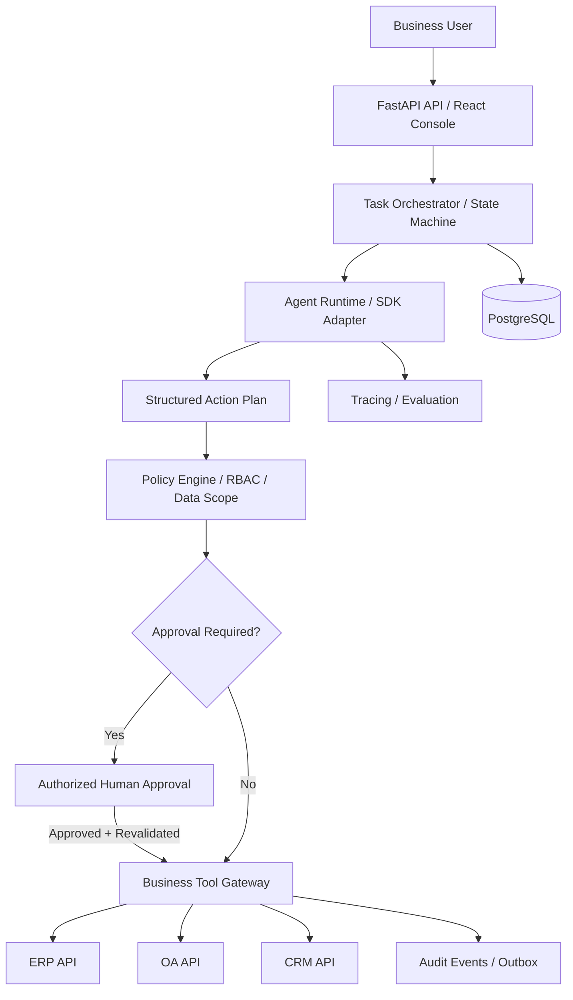

# Enterprise Agent Hub

> Enterprise AI Agent Execution & Governance Platform | 企业级 AI Agent 业务执行与治理平台

**Status:** Documentation-first V1.0 design. Implementation has not started.

Enterprise Agent Hub is an open-source, self-hosted execution and governance layer for AI agents working with existing enterprise ERP, OA and CRM systems.

**Design principle: Agents propose; deterministic services authorize and execute.** LLM output is never an authorization boundary.

## Architecture

## First Demo: Receivables Management

“Find receivables overdue more than 30 days, create collection follow-up tasks, and require management approval for individual amounts above RMB 100,000.”

Flow: authenticated request → authorized data access → Agent plan → deterministic validation → policy evaluation → approval if needed → idempotent ERP write → audit and outcome.

## Core Modules

- **Agent Runtime Adapter:** model and tool integration with structured plans.
- **Task Orchestrator:** durable state machine, retries and recovery.
- **Business Tool Gateway:** allowlisted tools, validation, access policy, idempotency.
- **Governance Engine:** RBAC, data scope, risk rules and human approval.
- **Business Connectors:** mock ERP initially; OA/CRM extensions later.
- **Observability & Evaluation:** tracing, audit and regression tests.

## Tech Stack (Proposed)

FastAPI, Python, OpenAI Agents SDK, PostgreSQL, SQLAlchemy, Redis, React, TypeScript, Docker Compose, pytest, OpenTelemetry.

## Documents

- [Product specification (V1)](docs/product/PRD-V1.md)
- [Architecture design](docs/architecture/overview.md)
- [Development roadmap](ROADMAP.md)

## Scope

V1 intentionally excludes building a complete ERP, drag-and-drop workflow builder, unrestricted autonomous writes, large-scale multitenancy and Kubernetes.

This repository is currently **a product and architecture specification**, not a working product. Contributions and feedback are welcome. License to be decided after dependency and intellectual-property review.
