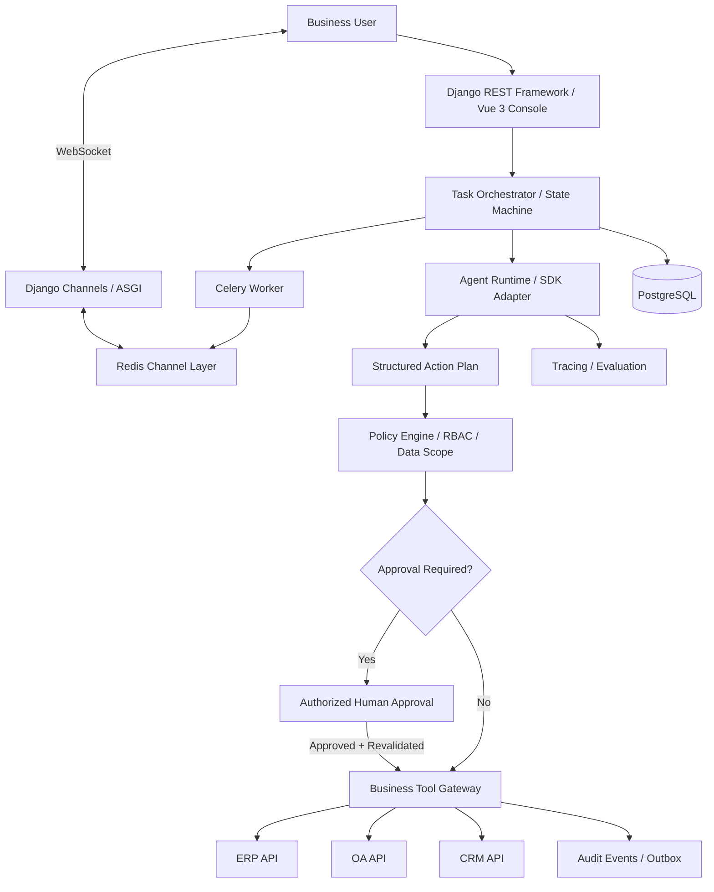
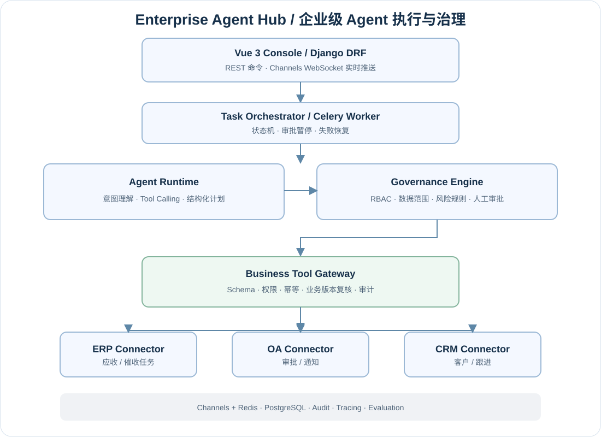

# Enterprise Agent Hub

**[English](README.md) | [简体中文](README.zh-CN.md)**

> Enterprise AI Agent Execution & Governance Platform | 企业级 AI Agent 业务执行与治理平台

**Status:** 基础管理系统及 Automation V2 已实现；Agent Runtime P1-C 的 Mock 只读闭环已实现；P2-A 模型配置、用量估算与协作取消已接入；P2-B 持久会话、上下文与 SSE RunEvent 已实现；AI 模型管理支持供应商模型同步、密钥加密与本地配置；治理/写工具仍处于设计阶段（截至 2026-11-18）。

Enterprise Agent Hub is an open-source, self-hosted execution and governance layer for AI agents working with existing enterprise ERP, OA and CRM systems.

**Design principle: Agents propose; deterministic services authorize and execute.** LLM output is never an authorization boundary.

## Architecture

## First Demo: Receivables Management

“Find receivables overdue more than 30 days, create collection follow-up tasks, and require management approval for individual amounts above RMB 100,000.”

Flow: authenticated request → authorized data access → Agent plan → deterministic validation → policy evaluation → approval if needed → idempotent ERP write → audit and outcome.

## Core Modules

- **Agent Runtime Adapter:** model and tool integration with structured plans.
- **Task Orchestrator:** durable state machine, retries and recovery.
- **Business Tool Gateway:** allowlisted tools, validation, access policy, idempotency.
- **Governance Engine:** RBAC, data scope, risk rules and human approval.
- **Business Connectors:** mock ERP initially; OA/CRM extensions later.
- **Observability & Evaluation:** tracing, audit and regression tests.

## Tech Stack (Proposed)

Python, Django, Django REST Framework, Django Channels (ASGI / WebSocket), channels_redis, Celery, PostgreSQL, Django ORM, Redis, Vue 3, TypeScript, Vite, Pinia, Element Plus, OpenAI Agents SDK, Docker Compose, pytest-django, OpenTelemetry.

**Messaging boundary:** REST for commands, approval decisions and authoritative queries; Django Channels WebSocket for progress, streaming events and notifications. Celery executes long-running tasks. PostgreSQL stores durable state; Redis messages are transient.

## Documents

- **[macOS 本地部署与功能验收指南 / Local setup and acceptance guide](docs/development/本地部署与功能验收指南.md)**: Django, Redis, Celery, Vue, Agent Mock, provider model sync and optional live model checks.

- **[平台层架构设计 V1（核心入口）](docs/platform-architecture/README.md)** — 总体架构、模块边界、领域模型、API、状态机、权限治理与 Codex 任务
- [现有 Celery 与数据库定时计划 V2](docs/development/automation-scheduler.md)
- **[Agent Runtime P1-C：模型适配、工具调用与执行中心](docs/platform-architecture/10-p1c-runtime-implementation.md)**
- **[P2-A：Model Gateway 配置、用量与运行治理](docs/platform-architecture/11-p2a-model-governance.md)**
- **[P2-B：会话、消息、上下文和 SSE 事件订阅](docs/platform-architecture/12-p2b-session-and-event-stream.md)**
- **[AI Model Management / Provider Catalog Sync](docs/platform-architecture/13-model-sync-management.md)**

- [Product specification (V1)](docs/product/PRD-V1.md)
- [Architecture design](docs/architecture/overview.md)
- [Django Channels realtime messaging](docs/architecture/realtime-communication.md)
- [Development roadmap](ROADMAP.md)

## Scope

V1 intentionally excludes building a complete ERP, drag-and-drop workflow builder, unrestricted autonomous writes, large-scale multitenancy and Kubernetes.

**Implemented baseline:** Django/DRF/Vue administration, existing user/role/menu management, Celery Worker, Redis, database-backed Cron scheduler, automation task execution API and front-end. **Not yet implemented:** the planned Agent Runtime, Model/Tool Gateway, business approval and full governance. Read the [platform architecture design](docs/platform-architecture/README.md) before implementing these modules. Contributions and feedback are welcome. License to be decided after dependency and intellectual-property review.
