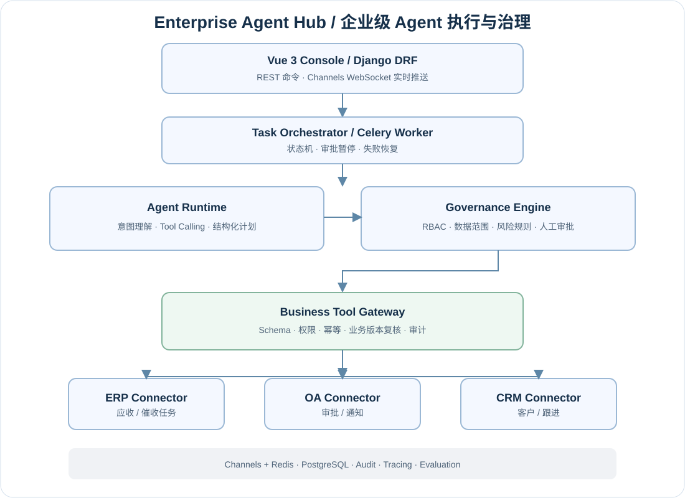
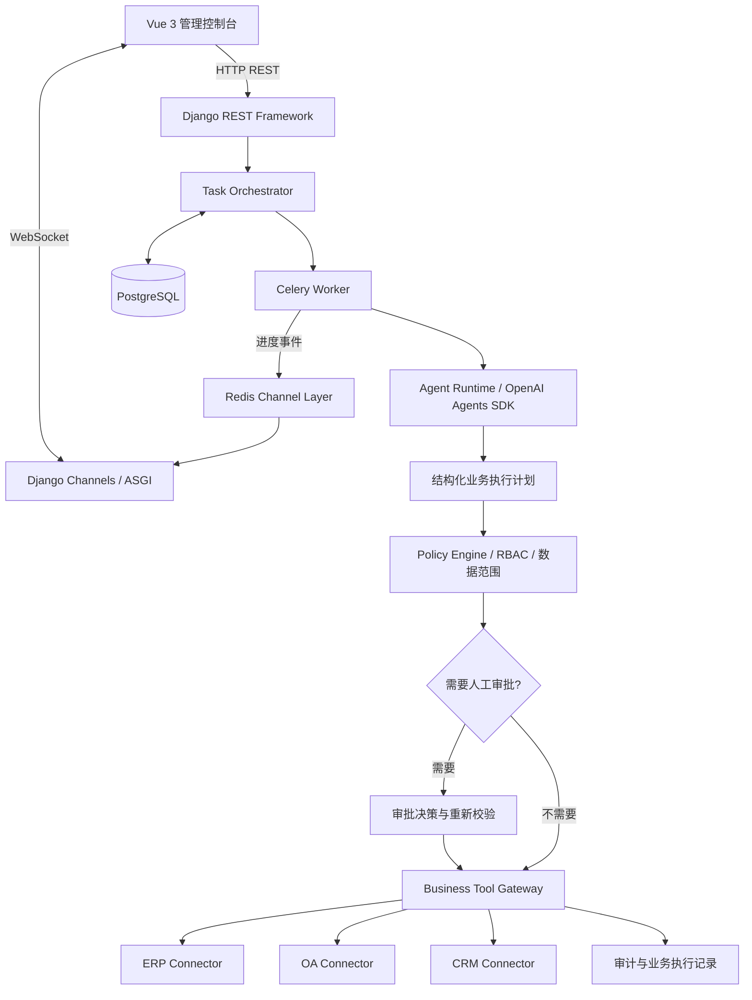

# Enterprise Agent Hub（企业级 AI Agent 业务执行与治理平台）

**[简体中文](README.zh-CN.md) | [English](README.md)**

> 使用 AI Agent 驱动既有 ERP、OA、CRM 等业务系统，在企业权限和业务规则约束下完成可审计、可恢复的业务操作。

**当前状态（2026-11-18）：Django/Vue 基础管理系统和 Celery/Cron 自动化任务 V2 已实现；Agent Runtime P1-C 的 Mock 只读闭环和执行中心已实现；P2-A 模型管理、用量估算与任务取消已接入；P2-B 持久会话、上下文和 SSE 执行状态订阅已实现；系统配置 → AI 模型管理支持供应商模型同步、加密密钥及本地二次配置；真实付费模型仍需配置密钥进行端到端联调，业务写入审批与完整治理仍待开发。**

## 项目愿景

企业已经有 ERP、OA、CRM 等系统；本项目不是重做 ERP，也不是普通的 AI 聊天机器人，而是在企业业务系统之上建设一层可复用的 **Agent 执行与治理平台**。

**架构原则：Agent 负责理解任务、查询和提出计划；确定性业务服务负责授权、审批、校验与最终写入。** 大模型输出不构成安全授权。

### 典型场景

用户提出：“查询逾期超过 30 天的应收账款，按责任人创建催收任务，单笔金额超过 10 万元的操作需要主管审批。”

系统应完成：

1. 用户认证、业务数据范围校验
2. Agent 调用已授权的 ERP 查询工具
3. 生成结构化、可审查的操作计划
4. 权限及风险策略校验
5. 高风险操作进入人工审批
6. 审批通过后复核业务数据并通过工具网关执行
7. 幂等写入催收任务并记录审计结果
8. 通过 WebSocket 向用户实时推送执行状态；异常可恢复或核对

## 总体架构

**通信与执行分工：** DRF 提供任务创建、查询、审批等 REST API；Django Channels 负责 WebSocket 连接和实时事件；Celery 负责长时间运行的 Agent 任务与重试；PostgreSQL 保存权威状态；Redis Channel Layer 负责临时跨进程消息分发，不承担持久化。

## 技术栈

| 方向 | 技术 |
| --- | --- |
| 前端 | Vue 3、TypeScript、Vite、Pinia、Element Plus |
| 后端 API | Python、Django、Django REST Framework |
| 实时通信 | Django Channels、ASGI、WebSocket、channels_redis |
| Agent 执行 | OpenAI Agents SDK（通过适配层隔离） |
| 后台任务 | Celery、Redis |
| 数据库 | PostgreSQL、Django ORM、Django migrations |
| 追踪与评测 | OpenTelemetry、pytest、pytest-django、Agent Evaluation |
| 部署 | Docker Compose、ASGI Server（Daphne） |

## 核心模块

- **Agent Runtime Adapter**：模型与 Tool 调用、结构化计划输出
- **Task Orchestrator**：持久任务状态机、暂停、恢复、重试
- **Business Tool Gateway**：工具白名单、Schema 校验、业务授权、幂等执行
- **Governance Engine**：RBAC、组织数据范围、风险策略、审批
- **Business Connectors**：首先提供模拟 ERP；后续支持 OA、CRM 等
- **Realtime Communication**：Channels + Redis 实时推送任务进度、Agent 增量输出和审批通知
- **Observability & Evaluation**：Tracing、审计事件、工程测试和效果评测

## 文档导航

- **[平台层架构设计 V1（最新实施基线）](docs/platform-architecture/README.md)**：模块边界、数据模型、API、状态机、权限、安全及 Codex 分阶段任务
- [已实现的自动化任务 / Cron 调度 V2](docs/development/automation-scheduler.md)
- **[已实现的 Agent Runtime P1-C 与首次部署](docs/platform-architecture/10-p1c-runtime-implementation.md)**
- **[P2-A 模型配置、用量估算与运行治理](docs/platform-architecture/11-p2a-model-governance.md)**
- **[P2-B 持久会话、上下文和 SSE 事件流](docs/platform-architecture/12-p2b-session-and-event-stream.md)**
- **[AI 模型管理与供应商同步模型](docs/platform-architecture/13-model-sync-management.md)**

- [产品说明书（PRD V1.0）](docs/product/PRD-V1.md)
- [总体技术架构](docs/architecture/overview.md)
- [Django Channels 实时通信设计](docs/architecture/realtime-communication.md)
- [开发路线图](ROADMAP.md)
- [SVG 架构图](docs/architecture/architecture.svg)

## V1 开发范围

第一阶段重点完成**自然语言任务 → 结构化执行计划 → 受控工具调用 → 人工审批 → ERP 业务写入 → 实时反馈**的一条闭环。

V1 **不包含**：完整 ERP、拖拽式流程设计器、通用 SaaS 多租户、无限制 Agent 自主写入、复杂多 Agent 系统以及 Kubernetes 微服务集群。

## 开源说明

仓库已有可运行的基础管理代码与 Automation V2；以上 Agent、Tool、审批与审计模块仍是目标架构，不能视作已上线功能。演示场景将使用虚构数据。新开发按 [平台架构设计 V1](docs/platform-architecture/README.md) 和 [ROADMAP](ROADMAP.md) 分阶段提交。开源许可证将在依赖及知识产权核查后确定，欢迎通过 Issues 提出改进建议。
