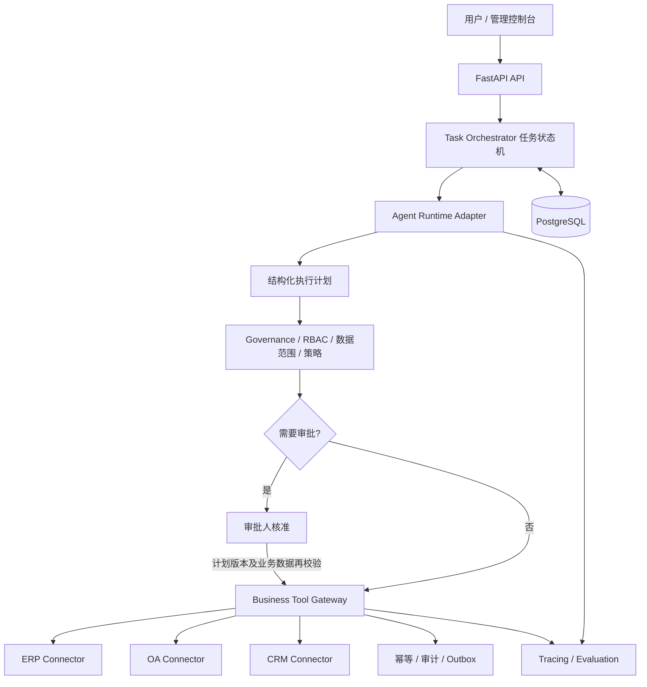

# 系统总体架构 / Architecture

## 设计原则

**Agent 负责理解意图与生成计划，确定性的执行系统负责审批、鉴权和最终业务写入。** 业务系统保持真实数据与规则的最终权威。

## 核心职责

| 模块 | 职责 |
| --- | --- |
| API / React Console | 身份、任务提交、审批和运行监控 |
| Task Orchestrator | 任务持久化、合法状态迁移、超时与恢复 |
| Agent Runtime | 模型 / Tool 调用、生成结构化计划，不直接落库 |
| Governance Engine | RBAC、数据权限、金额阈值、审批策略 |
| Business Tool Gateway | 工具白名单、参数校验、执行幂等、写入审计 |
| Connectors | 调用受限的 ERP / OA / CRM API |
| Observability | Trace、Metrics、Evaluation，与业务审计分离 |

## 生命周期

`CREATED → PLANNING → VALIDATING → READY → WAITING_APPROVAL(可选) → EXECUTING → SUCCEEDED`

异常状态：`RETRYING`、`FAILED`、`REJECTED`、`CANCELLED`、`NEEDS_RECONCILIATION`。

## 必须遵守的边界

- 模型输出是非可信输入；服务端做身份与权限的最终校验
- 通过审批只授权特定操作与计划版本，执行前重新读取业务数据
- 外部接口疑似成功但超时后，先核对远端状态，不能直接重复写入
- 幂等键由可信执行层生成并配合数据库唯一约束
- 不将密钥及敏感客户信息写入可公开 Tracing
- 所有演示数据必须为虚构数据

详见 [产品说明书](../product/PRD-V1.md)。
