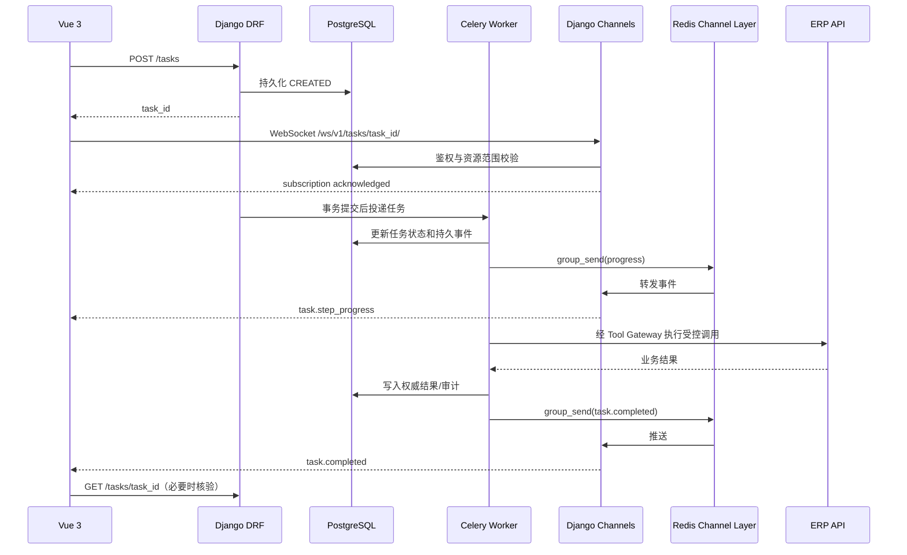

# Django Channels 实时通信架构设计（V1）

> 状态：设计文档，功能待实现。本文明确 HTTP、WebSocket、后台执行与持久化之间的边界。

## 1. 设计目标

- Vue 3 控制台实时接收 Agent 运行状态、增量文本、工具步骤、审批通知和最终执行结果。
- 业务写操作必须通过 Django REST Framework 入口完成身份认证、CSRF/Token 校验、资源权限检查与幂等控制。
- 即使 WebSocket 断线、重连或 Redis 消息丢失，也能通过 PostgreSQL 中的任务状态与事件记录恢复页面视图。
- 不允许通过 WebSocket 直接绕过 Tool Gateway 执行 ERP 写操作。

## 2. 组件与职责

| 组件 | 责任 | 不承担 |
| --- | --- | --- |
| Vue 3 + Pinia | HTTP 请求、WebSocket 订阅、事件展示和断线补查 | 持久化任务执行 |
| Django REST Framework | 创建、取消、审批、查询等权威业务 API | 长时间模型推理 |
| Django Channels / ASGI | WebSocket 握手、鉴权、任务事件订阅、推送 | 可靠消息队列或后台 Worker |
| channels_redis | Channel Layer 跨进程事件分发 | 持久化事件数据库 |
| Celery Worker | Agent 推理、任务执行、重试和补偿调度 | WebSocket 长连接管理 |
| PostgreSQL / Django ORM | 任务状态、审批、执行结果、持久事件与审计 | 瞬时消息广播 |

## 3. 拟定接口

### HTTP / REST

```http
POST   /api/v1/tasks
GET    /api/v1/tasks/{id}
GET    /api/v1/tasks/{id}/steps
GET    /api/v1/tasks/{id}/events?after_sequence=123
POST   /api/v1/tasks/{id}/cancel
GET    /api/v1/approvals
POST   /api/v1/approvals/{id}/approve
POST   /api/v1/approvals/{id}/reject
```

### WebSocket

```text
/ws/v1/tasks/{task_id}/
/ws/v1/notifications/
```

前端建立连接后，服务端必须从可信会话或受控认证上下文中确认身份，并验证当前用户对任务、通知频道和数据范围的访问权限。WebSocket 的来源校验、连接限制和认证过期处理必须纳入测试。

## 4. 统一事件协议

```json
{
  "type": "task.step_progress",
  "event_id": "evt_01",
  "task_id": "task_10001",
  "sequence": 42,
  "timestamp": "2026-11-17T06:00:00Z",
  "payload": {
    "step_id": "step_3",
    "status": "RUNNING",
    "message": "正在查询应收数据"
  }
}
```

建议的事件类型：

- `task.status_changed`：任务状态转换
- `task.step_progress`：步骤进度
- `agent.delta`：流式增量输出（高频事件，可能不逐条持久化）
- `approval.requested`、`approval.decided`：审批事件
- `task.completed`、`task.failed`：任务终结或异常

**建议：** 可恢复的业务事件使用单调递增的任务内 `sequence` 并落库；高频 Token 增量事件仅作为展示辅助，允许丢失后通过快照或最终结果补齐。前端不应把 Token 分片视为真实业务状态。

## 5. 任务消息时序



## 6. 可靠性规则

1. **先写库，后发事件。** 业务状态在数据库事务提交后才发布；失败则通过重试或 Outbox 补发。
2. **断线恢复。** Vue 3 按指数退避重连；重连后通过 REST 读取当前状态及持久事件增量，去重后更新 Pinia 状态。
3. **消息不等于命令。** WebSocket 仅订阅与通知，审批及高风险业务操作一律经 DRF API。
4. **并发防护。** 任务状态采用版本号/乐观锁；已完成、已拒绝或取消任务不能被迟到事件重新激活。
5. **幂等与对账。** Agent/ERP 写入携带可信操作 ID；超时后先核查远端是否已写入，再决定是否重试。
6. **背压和限流。** Agent 增量事件按窗口合并、限制频率与大小，避免每个 Token 都触发高开销广播。
7. **隐私与审计。** 不向未授权客户端推送数据；对 Agent 响应进行敏感字段脱敏；审计事件与临时流式数据分离。

## 7. 建议模块目录

```text
backend/
  config/
    asgi.py
    settings/
  apps/
    accounts/
    agents/
    tasks/
    approvals/
    governance/
    tool_gateway/
    connectors/
    realtime/
      consumers.py
      routing.py
      events.py
      permissions.py
  workers/
  tests/
frontend/
  src/
    api/
    stores/
    composables/
      useTaskSocket.ts
    views/
```

## 8. P0 验收

- 单用户和跨组织用户访问任务 WebSocket 时权限正确。
- 创建任务后 Vue 3 无刷新显示任务进度与结束状态。
- 审批通知实时可见，但审批操作仍需 REST 权限校验。
- 断开 WebSocket 重新连接后，页面可通过 REST 补齐状态。
- Redis 短暂不可用不导致任务权威状态丢失。
- Celery Worker 重试不产生重复 ERP 业务记录。
- 消息顺序错乱时前端不会回退到旧状态。

## 9. 技术备注

Django Channels 属于 ASGI 层的实时通信与协议处理框架；Channel Layer 不是 Celery 的替代品。尽量采用 Django 原生的权限、ORM 和 migrations；对异步 Consumer 的数据库访问按 Channels 的同步/异步边界规范处理。
