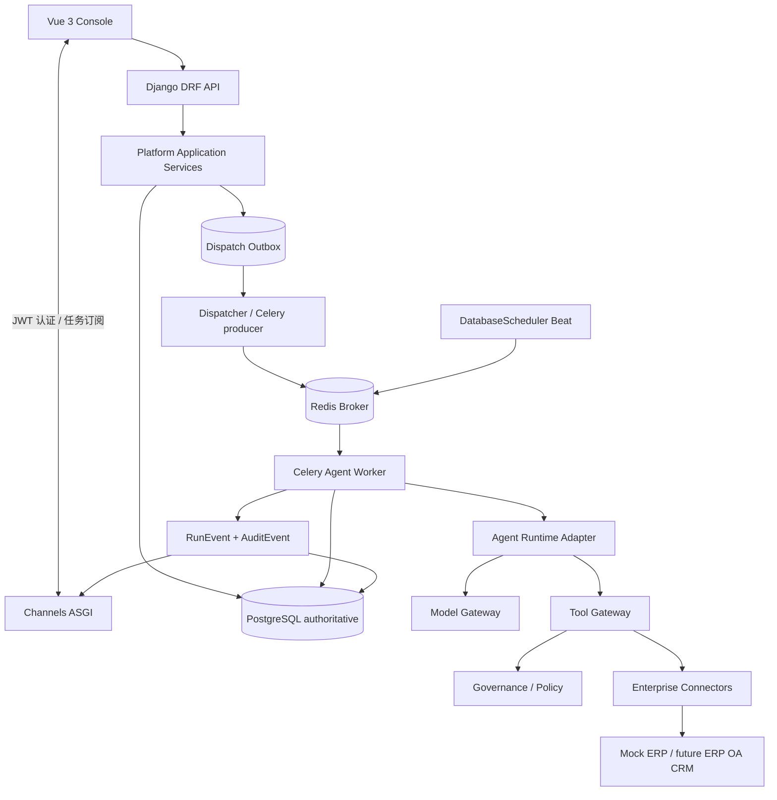

# 01 · 总体架构与模块边界

## 1. 物理部署与逻辑边界

推荐部署形态：一个 Django 代码仓库，API/Channels、Celery Worker、Beat、Outbox Dispatcher 独立进程；PostgreSQL、Redis、对象存储是基础设施。可先在单机 Docker Compose 部署，不必拆微服务。MVP 可在同一 Worker 运行 Dispatcher（管理命令）与 Run Worker **不同进程**；未来按压力独立扩容。

## 2. 模块职责和依赖方向

| 模块 | 归属 | 允许依赖 | 禁止 |
| --- | --- | --- | --- |
| `system`（已有） | 用户、角色、部门、菜单 | Django auth | 知道 SDK 细节 |
| `automation`（已有） | Cron、通用异步执行与结果 | Celery、DB | 直接解释 LLM 输出 |
| `platform_core`（后建） | ID、RequestContext、错误、事件契约 | stdlib / Django 抽象 | 汇总所有业务模型成 God Module |
| `agents` | Agent、不可变版本、ToolGrant、发布 | system、ModelProfile 引用 | 执行 Agent Loop |
| `model_gateway` | 提供商适配、凭据引用、模型路由、用量 | SDK/HTTP、Secret Store | 用户授权 / 工具决策 |
| `agent_runtime` | Run 状态、Session、Step、Loop、恢复 | agents、model_gateway、tool_gateway | 直接调用任意 ERP SQL |
| `tool_gateway` | 注册、Schema、参数校验、受控执行、连接器 | governance、Secret Store | 接受未经审批的任意函数名或任意 URL |
| `governance` | RBAC+对象权限+数据范围+Policy+Approval | system、稳定资源接口 | 用 Prompt 替代权限判断 |
| `observability` | Trace、RunEvent、用量、审计、评测 | 稳定事件接口 | 成为业务状态权威 |
| `workflows`（后续） | 多节点编排、暂停恢复、补偿 | Runtime、Governance | P0 建立全套拖拽设计器 |
| `apps/*` | 模拟 ERP / 后续应用 | Tool Gateway 的插件协议 | 反向修改 Runtime 核心 |

**依赖规则**：所有跨模块访问走应用服务或明确的协议；只有仓库级编排层组合各组件；不要让底层模型 import 上层 API/运行循环。

## 3. 请求与任务的职责

- **API**：验证 JWT、资源访问权限、提交命令与可靠写库；返回 `202 Accepted` 与 `run_id`，不在 HTTP 同步等待模型输出。
- **Agent Runtime**：读取发布版本快照，维护轮次/工具预算，调用模型与工具，保存步骤和会话状态。
- **Celery**：提供异步消费者、队列、执行超时与并发隔离。消息只包含 `run_id` / `step_id` 等受控标识。
- **Beat**：调度可信 task definition（例如 `platform.run_agent`），不直接加载开放的 Python 函数名；启用前经过授权与配额校验。
- **DB + Outbox**：持久状态、派发意图、审计和事件提交在同一事务内完成，DB 是最终真相；Redis/Channels 仅提供传递。
- **Channels**：推送进度/Token 片段/审批通知；每个订阅在握手及资源订阅时校验权限，断线后用 REST/event cursor 补查。

## 4. Agent Runner 内部组件

1. `ExecutionService.start_run(actor, agent_version, input, idempotency_key)`：授权、预算、快照、创建数据库记录及 Outbox。
2. `RunDispatcher.dispatch(run_id)`：幂等入队；同一 Run 仅允许一个有效执行租约。
3. `RuntimeAdapter.run(context)`：支持 SDK 实现替换，不让 Django API 直接绑定 SDK 类。
4. `ModelGateway.generate(model_profile, messages, tools, budget)`：模型请求、超时、速率限制、用量及脱敏。
5. `ToolGateway.invoke(tool_code, args, execution_context)`：Schema 校验、工具授权、风险策略、幂等/审计。
6. `StateRepository`：比较并交换状态版本，追加 Step / RunEvent；事务内写 Outbox。
7. `Notifier`：按已提交事件推送 Channels；失败可重发。

## 5. 选用现有代码的边界

- 现有 `automation.TaskExecution` 继续记录 `ping`/`database_probe` 的任务；**AgentRun 不修改为该表的继承类**。可通过 `automation_execution_id`（可空）建立关联，后续如接入计划创建 AgentRun，由可信 Adapter 完成映射。
- 现有 `system.Users`、`Role`、`Dept` 继续使用；另建 `AgentAccessGrant`、`ToolGrant` 与客体范围，不复用“能看到菜单”推断“能操作 ERP”。
- 当前 `USE_TZ=False`；新 Run/审批事件必须记录带时区语义的 UTC 时间。实施前先选定迁移策略（ADR），不能将本地 naive 时间与 UTC 混合排序。
- 现有 frontend 是 Vue SFC JavaScript，不强制一次性迁移 TypeScript；新模块可以逐步引入 TS，但 CI 先保证 Vite/Vitest 构建与测试。

## 6. 业务演示与未来泛化

第一条演示：授权用户提交“分析本月销售变化”。Tool Gateway 调用本地虚构经营数据的只读工具并记录 Trace。替换工具后仍复用同一 Runner。

下一条演示：模拟 ERP 应收催收，需要特定写操作的 Policy、审批、幂等、Outbox、对账能力。这是对 **Tool Gateway 和 Governance 的扩展测试**，不是在平台核心硬编码“应收”领域。
