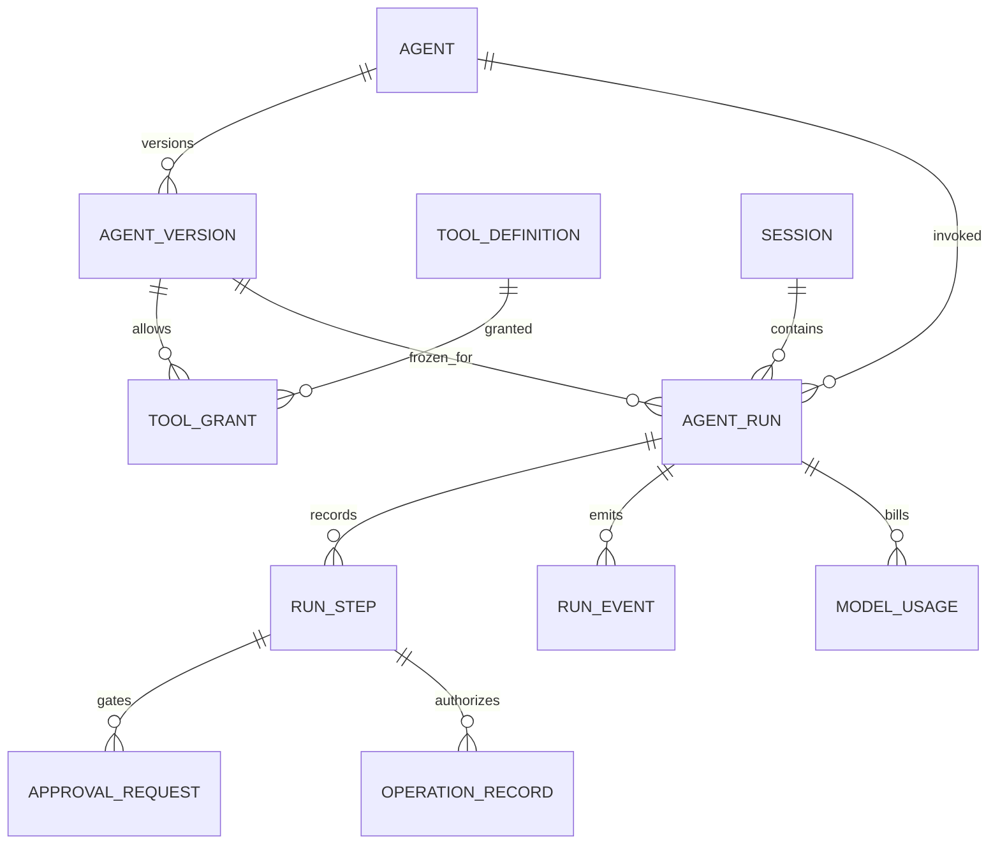

# 02 · 领域模型与数据库设计

> 下述是 **目标数据模型草案**，不是已经执行的 Django Migration。建议按模块 P0→P3 逐步创建模型，每批都运行 `makemigrations --check --dry-run` 和 PostgreSQL 集成测试。标识建议 UUID（可生成 UUIDv7/UUID4，P0 默认 UUID4），数据库使用主键和唯一约束保护幂等。

## 1. 核心实体

| 表 / Django Model | 主字段与约束 | 说明 |
| --- | --- | --- |
| `agents_agent` | id, code(unique), name, owner_id, status, published_version_id?, created_at | Agent 身份，不承载可变 Prompt 的历史 |
| `agents_agentversion` | id, agent_id, version_number(unique(agent,version)), spec_json, prompt_checksum, model_profile_id, published_at?, created_by | **已发布不可变**；后续修改产生新版本 |
| `agents_agentaccessgrant` | id, agent_id, principal_type/id, capability, scope_json, expires_at?; unique | 用户/角色能否执行/管理 Agent |
| `agents_toolgrant` | id, agent_version_id, tool_definition_id, policy_scope, enabled; unique(version,tool) | Agent **版本级**允许使用的工具 |
| `model_gateway_provider` | id, code(unique), adapter_type, status, secret_ref | 模型提供商配置；不存明文 key |
| `model_gateway_modelprofile` | id, provider_id, model_code, configuration, enabled, pricing_version, cost_limits | 模型参数/成本/限额可审核 |
| `tool_gateway_tooldefinition` | id, code(unique), kind, version, input_schema, output_schema, risk_level, credential_ref?, enabled | 只允许管理员发布的工具 |
| `agent_runtime_session` | id, owner_id, title, agent_id, created_at, last_message_at, state | 会话容器；消息按服务端权限范围读取 |
| `agent_runtime_message` | id, session_id, run_id?, seq, role, content_ref_or_redacted, created_at; unique(session,seq) | 不默认永久保存完整敏感提示词 |
| `agent_runtime_run` | id, agent_id, version_id, session_id?, requested_by_id, status, status_version, input_ref/redacted, snapshot_json, idempotency_key, lease_owner?, lease_until?, started_at?, finished_at?, deadline_at?, error_code?, result_ref?, automation_execution_id? | **Agent 执行状态真相**； unique(requested_by, idempotency_key) 与作用域限定 |
| `agent_runtime_step` | id, run_id, seq, type, status, tool_code?, input_digest, result_ref?, started_at?, finished_at?, retry_of?; unique(run,seq) | 模型/工具/审批等执行步骤 |
| `agent_runtime_event` | id, run_id, seq, event_type, payload_redacted, created_at; unique(run,seq) | 给 REST 游标/WS 补偿的顺序事件 |
| `agent_runtime_dispatchoutbox` | id, aggregate_type, aggregate_id, event_type, payload, status, attempt_count, next_attempt_at, created_at, sent_at?, unique(message_key) | 事务内可靠记录派发意图 |
| `governance_policy` | id, resource_type, action, version, rule_json, enabled, effective_at | 版本化规则；默认拒绝 |
| `governance_approvalrequest` | id, run_id, step_id, operation_digest, actor_id, policy_version, status, expires_at, resolved_by?, resolved_at?, reason? | 审批只绑定操作快照、业务版本、受控范围 |
| `governance_operationrecord` | id, operation_id(unique), run_id, step_id, tool_id, business_key, idempotency_key(unique(scope,key)), status, remote_ref?, reconciliation_status | 外部写入、超时对账与重放防护 |
| `observability_toolcall` | id, run_id, step_id, tool_code, latency_ms, status, error_category, trace_id | Tool 调用可观测数据（不含秘密） |
| `observability_modelusage` | id, run_id, step_id, provider, model_code, input_tokens, output_tokens, cached_tokens?, estimated_cost, price_snapshot, trace_id | 用量/计价；钱采用 Decimal |
| `observability_auditevent` | id, actor_id, action, resource_type/id, policy_result, operation_id?, request_id, occurred_at, metadata_redacted | **追加式审计事件**；业务日志独立于模型 Trace |

## 2. 关系与约束

**不变量**：

- `AgentVersion` 发布后不可原地修改；`Run.snapshot_json` 固化模型配置、工具授权集合、Prompt 摘要和策略版本；凭据引用不能复制为密钥明文。
- `Run` 的 `status_version` 每次转移 +1；仅允许持有有效租约的 Worker 推进，不允许最后写入覆盖前一个终态。
- `Step` 的 `seq` 在单 Run 内单调递增；`RunEvent` 事件号在数据库事务内分配，不使用 Redis 自增作为权威序列。
- `idempotency_key` 由客户端提供时绑定 actor + API 作用域 + request_hash；同一个 key 更换参数返回 409，不能悄悄复用其他结果。
- 外部业务写入必须唯一 `operation_id`；“同一业务对象、同一动作”的去重范围取决于连接器协议，不以 Celery task_id 当业务幂等键。
- `approval` 过期、拒绝、版本失效或业务数据版本变化后，任何旧批准均不得继续执行。
- `TaskExecution` 与 `AgentRun` 的状态**分开存储**。前者是 Automation 记录，后者是 Agent 语义执行；可选关联但不覆盖历史数据。

## 3. 典型索引、并发与保留

- Run：`(requested_by_id, created_at DESC)`、`(status, deadline_at)`、`(lease_until, status)`；Session：`(owner_id, last_message_at)`。
- Step/Event：`(run_id, seq)` unique；Approval：`(status, expires_at)`；Outbox：`(status, next_attempt_at, id)`。
- 使用事务 + 条件更新实现状态 CAS；需要时对 `Run` 行 `select_for_update`。对外写操作与 Agent 状态更新禁止形成长事务锁。
- 大型工具结果/模型输出存对象存储（可配置 OSS/S3），数据库保存受限摘要、内容 hash、加密引用和保留期。
- 按企业安全策略配置 Trace/会话的保留期与脱敏，不在测试和生产环境使用明文凭据。
- 数据库迁移可回滚需要专门验证；与旧 `system` 或 `automation` 表的关系新增 nullable 字段，采用 Expand → Backfill → Contract。

## 4. 分阶段建表顺序

1. **P0**：只定义 schema / ADR，无迁移。
2. **P1**：Agent、AgentVersion、ModelProvider/ModelProfile（只读引用）、ToolDefinition/ToolGrant、AgentRun/RunStep/RunEvent、DispatchOutbox，先做只读 Tool。
3. **P2**：Session/Message、额度与 Usage、ToolCall、连接器凭据管理。
4. **P3**：Policy、ApprovalRequest、OperationRecord、AuditEvent，加入可写 Tool 的对账。
5. **P4**：Workflow 图、节点状态等，避免提前建空表。

## 5. 时间与数据库决策

当前 Django 为 `TIME_ZONE=Asia/Shanghai`、`USE_TZ=False`，且已有 Automation 迁移。**P1 前必须先决定如何迁移 UTC aware 时间戳**；推荐新部署切换 `USE_TZ=True`、统一 UTC 存储，历史 naive 字段按明确 Asia/Shanghai 假设转换并有数据校验/回滚。不能直接修改设置后宣称历史时间自动正确。生产用 PostgreSQL；CI SQLite 只是快速测试补充，不替代 PostgreSQL 权限/事务/并发验收。
