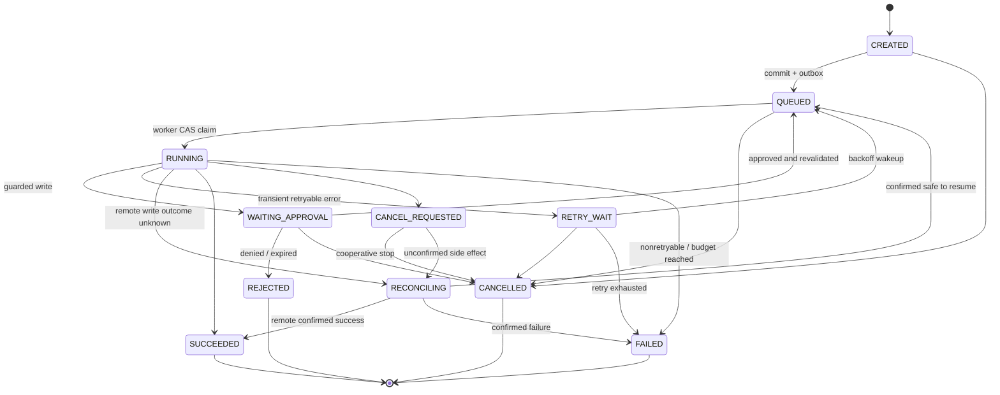

# 04 · Agent 执行状态机、派发与故障恢复

> 所有图表为 **目标设计**；目前 `automation.TaskExecution` 仅支持检测任务的四态，不代表 AgentRun 状态机已经实现。

## 1. AgentRun 状态机



`CREATED`、`QUEUED`、`RUNNING`、`SUCCEEDED`、`FAILED` 属于 P1；`WAITING_APPROVAL`、`REJECTED`、`RECONCILING` 属于治理阶段。未实现的状态不能在 API 上伪造成功。

**终态**：`SUCCEEDED`、`FAILED`、`REJECTED`、`CANCELLED`。`RECONCILING` 不是终态，不能自动假定成功或失败。无已知写操作时，可取消正在运行的只读步骤；涉及不可确定结果的写操作必须先核对。

## 2. Run / Step 并发不变量

1. Run 创建时保存确定的 `agent_version_id`、模型和工具配置快照、请求上下文摘要、授权版本、`status_version=1`，并在**同一事务**写 `DispatchOutbox`。
2. Dispatcher 从 Outbox 派发 `run_id` 到 Celery；失败重试有退避、次数、异常分组和告警。消息可以重复，但目标 Run 只允许一个有效租约。
3. Worker 用 `UPDATE ... WHERE status='QUEUED' AND status_version=N` 声明持有权并生成 `lease_owner`、`lease_until`；重入消息无法重复 claim。
4. 所有状态变更在 DB 事务内追加 `RunEvent` 和必要审计，事件外发安排在 commit 之后。
5. 长执行在每个 SDK Tool/模型轮次后 checkpoint。Worker 崩溃后，由 Reconciler 检查租约和最后已提交的 Step，**不能从头盲目执行有副作用的 Tool**。
6. 不允许最后的异步消息将终态改回 `RUNNING`；状态不合法返回冲突并记录审计。
7. 协作式取消通过数据库 `CANCEL_REQUESTED` + Worker 边界检查。强杀 Celery Worker 不是外部写入事务回滚。
8. 先执行 Token/工具调用/墙钟限额检查；超预算拒绝下一步，按错误分类转 `FAILED`（或请求人工处理）。

## 3. Step 类型与写操作序列

Step 类型：`MODEL_CALL`、`TOOL_READ`、`TOOL_WRITE`、`APPROVAL`、`CHECKPOINT`。P1 只启用 MODEL_CALL、TOOL_READ、CHECKPOINT。

Tool WRITE 在 P3 才开放：

```text
LLM 提议工具参数（不可信）
 -> 服务端 JSON Schema / 类型 / 长度 / 白名单验证
 -> ToolGrant + Actor RBAC/数据范围
 -> Policy 评价 risk and business version
 -> 高风险? 创建 ApprovalRequest -> WAITING_APPROVAL
 -> 获准且未超期? 再校验策略版本 + 当前业务状态
 -> 对应 OperationRecord 创建 operation_id/idempotency_key
 -> 调用 Connector
 -> 远端确认成功 -> 持久结果、审计
 -> 网络超时/未知 -> RECONCILING（禁止直接再次写）
```

模型/工具 API 不能被 Worker 直连绕过 Gateway；建议 Gateway 的“调用”是唯一导出服务入口。

## 4. Outbox 和可靠派发

建议 `DispatchOutbox` 字段：`message_key(unique)`、`run_id`、`kind`、`status(PENDING/SENDING/SENT/ERROR)`、`next_attempt_at`、`attempt_count`、`last_error_code`、`sent_at`。Dispatcher 可以通过 PostgreSQL `FOR UPDATE SKIP LOCKED` 批量锁定记录并派发。

重要：**“数据库写记录成功”不等于“Celery 已收到消息”**。只用 `transaction.on_commit(lambda: task.delay(...))` 会在 DB 已提交但 Broker 临时故障时丢失任务；Outbox 可由独立重放器补发。即使 Outbox 标记 SENT 的进程崩溃，也可能重复投递，依赖 Run claim/操作幂等处理。不得对数据库状态与 Redis 投递宣称跨系统 exactly once。

## 5. 失败类型和恢复策略

| 故障 | 分类 | 行为 |
| --- | --- | --- |
| LLM 429 / 临时 5xx | transient | 指数退避 + jitter + 上限；预算不足则失败 |
| 模型请求超时、尚未开始 Tool 写入 | transient | 可重试模型轮次；关联上一轮事件并控制重复成本 |
| 参数 Schema 不匹配 | permanent | 拒绝当前 Tool，不调用外部服务；可反馈模型有限次修正 |
| 权限变化 / AgentVersion 被撤销 | forbidden | 安全停止，记录授权变化；不能沿用旧 Grant |
| Worker 崩溃，Run lease 过期 | recoverable | 恢复到最新持久 checkpoint，确认步骤幂等 |
| 连接器查询超时（只读） | transient | 可重试，但配置速率/次数 |
| 连接器写入超时，远端结果不确定 | unknown | 转 `RECONCILING`；先查 remote operation_id |
| 审批拒绝或过期 | terminal | `REJECTED`；原批准不可复用 |
| 取消发生在外部调用之后 | ambiguous | 先确认远端结果，按策略转 CANCELLED 或 RECONCILING |
| DB 故障，无法持久化成功结果 | critical | Worker 不宣称业务完成，按操作 ID 核对；告警 |

## 6. 与现有 Automation V2 的映射

- `automation.TaskExecution` 的状态、API、Cron 行为**保持不变**；继续提供系统任务/定时检测功能。
- 在任务调度扩展中只引入**可信的 `agent_run` TaskType**（P2/P3），保存 `AgentRun.id`，异步执行仅通过 `AgentRunDispatcher`，不接受任意客户端提供的 SDK callable。
- `TaskSchedule` 触发 Agent 时应创建 AgentRun 并关联 `automation_execution_id`（若需要统一展示）。AgentRun 的状态才是 Agent 执行真相，不能用 TaskExecution 的四态硬映射审批/对账状态。
- 同分钟触发去重属于调度层；每个 AgentRun 还必须独立使用 Run 幂等键，防止 HTTP / WS / Worker 重试重复运行。

## 7. 关键测试（必须自动化）

- 相同 `Idempotency-Key` 重复 POST → 同一 Run；不同 body → 409。
- 两个 Worker 同时 claim 同一 Run → 只有一个执行。
- Broker 故障后恢复 → Outbox 继续派发，不丢任务。
- Worker 中途崩溃 → 重试只执行未完成的可重试步骤。
- ToolGrant 被撤销 → 后续调用被拒绝，即使 Agent 版本配置仍含该工具。
- 审批前失败 → 不调用写 Tool；审批后业务版本变化 → 重新校验并拒绝旧批准。
- 远端写入超时 → NEEDS_RECONCILIATION，不盲重试。
- WS 重连 → REST 事件补偿、seq 去重，最终状态一致。
- 与现有 Automation 的迁移和测试保持通过。
